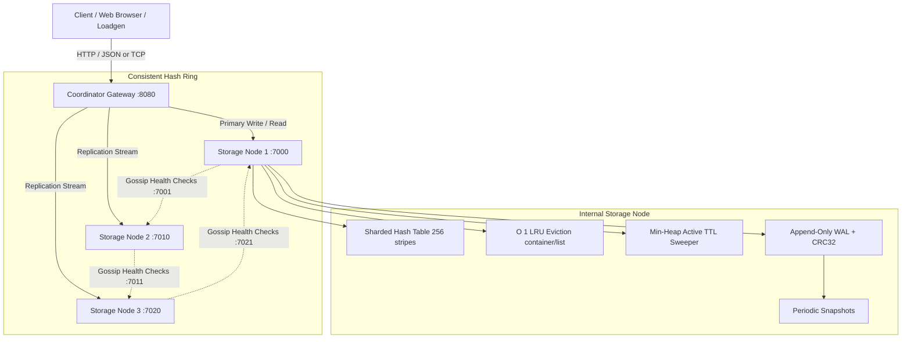

# miniKV

A miniature distributed key-value store in Go (1.22+) featuring consistent hashing with virtual nodes, append-only Write-Ahead Logging with CRC32 integrity checks, O(1) LRU eviction, active min-heap TTL expiration, async/sync replication, gossip-based failure detection, and an embedded web dashboard.

---

## Architecture Overview



---

## Key Features

1. **Core Commands**: `GET`, `PUT` (with optional TTL), `DEL`, `EXISTS`, `TTL`, `KEYS` (prefix scan), `STATS`.
2. **O(1) LRU Cache Eviction**: Backed by `container/list` and hash map. Configurable limits for `max-entries` and `max-bytes` with atomic eviction counters.
3. **Active TTL Sweeper**: Combines lazy expiry on read with a background min-heap sweeper running every 100ms. No full table scans.
4. **Reliable Persistence**: Append-only WAL with CRC32 frame checksums and selectable fsync policies (`always`, `every-second`, `none`). Crash recovery replays snapshot followed by WAL logs with graceful handling of torn trailing records.
5. **Consistent Hashing**: Ring implementation with 128 virtual nodes per physical host, binary search lookup (`sort.Search`), and deterministic key partition mapping.
6. **Replication & Failover**: Master-to-replica write streaming with sequence tracking. Supports both asynchronous mode and synchronous N-ack confirmation.
7. **Gossip Failure Detection**: Node liveness detection with `Alive`, `Suspect`, and `Dead` state transitions.
8. **Minimalist Web Dashboard**: Embedded directly into the coordinator binary via `go:embed`. Built with vanilla JS, HTML5, CSS3, and Alpine.js. Includes cluster status, live SVG hash ring, interactive console, data explorer, and real-time SSE metric streams.

---

## Quickstart

### 1. Build Binaries
```bash
go build -o minikv-node ./cmd/minikv-node
go build -o minikv-coord ./cmd/minikv-coord
go build -o loadgen ./cmd/loadgen
```

### 2. Run Local 3-Node Cluster
On Linux/macOS:
```bash
chmod +x ./scripts/run-cluster.sh
./scripts/run-cluster.sh
```

On Windows (PowerShell):
```powershell
.\scripts\run-cluster.ps1
```

Once running, access the dashboard at:
**http://localhost:8080**

---

## Benchmark Results

Benchmark conducted locally on the storage cluster with `cmd/loadgen`:

| Metric | Result |
|---|---|
| **Concurrency** | 8 Goroutines |
| **Duration** | 3.0 Seconds |
| **Read / Write Ratio** | 80% Reads / 20% Writes |
| **Total Operations** | 12,665 |
| **Throughput** | **4,220.58 ops/sec** |
| **Latency p50** | 1.707 ms |
| **Latency p95** | 3.129 ms |
| **Latency p99** | 4.330 ms |
| **Errors** | 0 (0.00%) |

---

## API Reference

### Coordinator HTTP API (`:8080`)

| Method | Endpoint | Description |
|---|---|---|
| `GET` | `/api/v1/kv/{key}` | Fetch key value and remaining TTL |
| `PUT` | `/api/v1/kv/{key}` | Store key with optional `value`, `ttl_ms`, and `sync` flag |
| `DELETE` | `/api/v1/kv/{key}` | Delete key |
| `GET` | `/api/v1/kv?prefix={p}` | List keys matching prefix |
| `GET` | `/api/v1/stats` | Cluster-wide aggregated metrics |
| `GET` | `/api/v1/nodes` | List registered nodes and replication lag |
| `GET` | `/api/v1/ring?key={k}` | Inspect hash ring and virtual node mappings |
| `POST` | `/api/v1/console` | Execute interactive console commands (`GET`, `PUT`, `DEL`, etc.) |
| `GET` | `/api/v1/events` | Server-Sent Events (SSE) live metric stream |
| `POST` | `/api/v1/bench/run` | Trigger synthetic benchmark from UI |

### Storage Node TCP Protocol (`:7000`)

Line-based RESP-like protocol:
- `GET <key>\r\n` -> `$<len>\r\n<data>\r\n` (or `$-1\r\n` if not found)
- `PUT <key> <ttl_ms>\r\n<val_len>\r\n<val>` -> `+OK\r\n`
- `DEL <key>\r\n` -> `:1\r\n` (or `:0\r\n`)
- `EXISTS <key>\r\n` -> `:1\r\n` (or `:0\r\n`)
- `TTL <key>\r\n` -> `:<ms>\r\n`
- `KEYS <prefix>\r\n` -> `*<count>\r\n...`
- `STATS\r\n` -> `$<len>\r\n<json_stats>\r\n`
- `PING\r\n` -> `+OK\r\n`

---

## Design Decisions and Trade-offs

- **CAP Position**: miniKV occupies the **AP** space (Available / Partition Tolerant) under its default asynchronous replication setting. Writes complete at the primary node without waiting for replica round-trips, ensuring low latency. For scenarios requiring strong consistency, callers can toggle synchronous replication per request (`sync=true` with configurable replica ack count `sync_n`).
- **Sharded Locking**: Memory store splits the key space across 256 independent mutex-locked stripes (`sync.RWMutex`). This reduces thread contention under high concurrency.
- **Min-Heap for TTL Indexing**: Using a priority queue min-heap per shard allows finding the next earliest expiring entry in O(1) time and updating/removing in O(log n) time, completely eliminating O(N) full-table expiration sweeps.
- **CRC32 Checksummed WAL**: Each WAL frame includes a CRC32 checksum over the record length and payload. In the event of a system crash during an in-flight write, the recovery scanner verifies frames sequentially and safely truncates the damaged trailing frame without aborting whole-node recovery.
- **Embedded Web UI**: By compiling web assets into the coordinator binary using `go:embed`, deployment remains a single zero-dependency binary.
