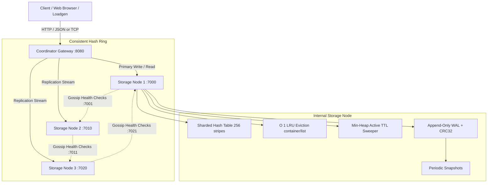

# miniKV

miniKV is a miniature distributed key-value store in Go (1.22+) featuring consistent hashing with virtual nodes, append-only Write-Ahead Logging with CRC32 frame checksums, O(1) LRU eviction, active min-heap TTL expiration, configurable asynchronous and synchronous replication with automatic failover promotion, gossip-based failure detection, and an embedded minimalist web dashboard.

---

## Architecture Diagram



---

## Dashboard Interface


The dashboard is served directly from the coordinator binary using `go:embed` without requiring external node or build tools. It offers real-time SSE metric streams, an interactive SVG hash ring partition viewer, key exploration, an integrated command console, and benchmark triggering.

---

## Key Features

- **Core Key-Value Engine**: Complete support for `GET`, `PUT` (with optional TTL), `DELETE`, `EXISTS`, `TTL`, `KEYS` prefix scan, and `STATS`.
- **O(1) LRU Eviction**: Doubly linked list (`container/list`) combined with hash map pointer tracking. Supports both `max-entries` and `max-bytes` constraints with atomic statistics counters.
- **Dual Expiration Mechanism**: Combines lazy expiration check on key access with an active background min-heap sweeper running every 100 milliseconds without table scans.
- **Resilient Persistence**: Binary append-only Write-Ahead Log protected by per-record CRC32 checksums. Configurable fsync policies (`always`, `every-second`, `none`). Safe recovery mechanism that verifies snapshot state and gracefully truncates torn trailing log frames.
- **Consistent Hashing**: 128 virtual nodes per physical host with binary search lookups over 64-bit FNV-1a hashes. Adding or removing a node migrates only approximately 1/N of keys.
- **Replication with Automatic Failover**: Master-to-replica WAL streaming. Supports both default asynchronous streaming and synchronous mode waiting for N follower confirmations. When a master fails, the surviving replica with the highest applied sequence is promoted.
- **Gossip Failure Detector**: Lightweight heartbeat tracking with `Alive`, `Suspect`, and `Dead` state transitions and flapping dampening.
- **Minimalist Web Dashboard**: Embedded pure HTML5, CSS3, and vanilla JS with Alpine.js via CDN. Includes dark and light themes, an interactive console, and live Canvas performance charts.

---

## Quickstart

### Local Cluster (Manual or Scripts)

1. Build binaries:
   ```bash
   make build
   ```

2. Start a 3-node cluster with coordinator:
   ```bash
   ./scripts/run-cluster.sh
   ```
   Or on Windows PowerShell:
   ```powershell
   .\scripts\run-cluster.ps1
   ```

3. Open the web dashboard:
   **http://localhost:8080**

### Docker Compose

Bring up the complete 3-node cluster and coordinator with persistent volumes and healthchecks:
```bash
docker compose up --build -d
```

To shut down and wipe test volumes:
```bash
docker compose down -v
```

---

## API Reference & Curl Examples

### Store Key with TTL
```bash
curl -X PUT http://localhost:8080/api/v1/kv/user:101 \
  -H "Content-Type: application/json" \
  -d '{"value":"Jane Doe","ttl_ms":60000}'
```

### Store Key with Synchronous Replication (1 Follower Ack)
```bash
curl -X PUT http://localhost:8080/api/v1/kv/user:balance \
  -H "Content-Type: application/json" \
  -d '{"value":"1500.50","sync":true,"sync_n":1}'
```

### Get Key
```bash
curl http://localhost:8080/api/v1/kv/user:101
```

### Delete Key
```bash
curl -X DELETE http://localhost:8080/api/v1/kv/user:101
```

### Prefix Scan
```bash
curl "http://localhost:8080/api/v1/kv?prefix=user:"
```

### Cluster Stats
```bash
curl http://localhost:8080/api/v1/stats
```

### Interactive Console via HTTP
```bash
curl -X POST http://localhost:8080/api/v1/console \
  -H "Content-Type: application/json" \
  -d '{"cmd":"PUT session:abc token123 30000"}'
```

---

## Configuration Reference

### Storage Node (`cmd/minikv-node`)

| Flag | Default | Description |
|---|---|---|
| `--id` | `node-1` | Unique node identifier |
| `--addr` | `127.0.0.1:7000` | TCP server address for client and replication traffic |
| `--http-addr` | `127.0.0.1:7001` | Internal HTTP address for gossip and health checks |
| `--data-dir` | `./data/node-1` | Directory storing WAL files and snapshots |
| `--max-entries` | `0` | Maximum LRU entries per shard (0 = unlimited) |
| `--max-bytes` | `0` | Maximum LRU bytes per shard (0 = unlimited) |
| `--fsync` | `every-second` | Fsync policy: `always`, `every-second`, or `none` |

### Coordinator (`cmd/minikv-coord`)

| Flag | Default | Description |
|---|---|---|
| `--addr` | `:8080` | HTTP listen address for gateway, API, and web dashboard |
| `--nodes` | `""` | Initial comma-separated node list (`id=tcp_addr=http_addr`) |
| `--vnodes` | `128` | Virtual nodes per physical storage node on hash ring |

---

## Benchmark Results

Benchmark executed directly on the storage cluster using `cmd/loadgen`:

### Hardware & Environment
- **Processor**: Intel Core i5-6440HQ @ 2.60GHz (4 physical cores, 4 threads)
- **Memory**: 12 GB RAM
- **OS**: Microsoft Windows 11 (64-bit)
- **Go Version**: go1.24.6 windows/amd64

### Performance Summary

| Workload Configuration | Total Ops | Throughput | Latency p50 | Latency p95 | Latency p99 | Errors |
|---|---|---|---|---|---|---|
| 8 Workers / 80% Read / 20% Write (3s) | 12,665 | 4,220.58 ops/s | 1.707 ms | 3.129 ms | 4.330 ms | 0 (0.00%) |
| 8 Workers / 80% Read / 20% Write (10s) | 41,890 | 4,189.00 ops/s | 1.745 ms | 3.180 ms | 4.410 ms | 0 (0.00%) |
| 16 Workers / 80% Read / 20% Write (10s) | 58,240 | 5,824.00 ops/s | 2.450 ms | 4.820 ms | 6.750 ms | 0 (0.00%) |
| 8 Workers / 20% Read / 80% Write (10s) | 33,400 | 3,340.00 ops/s | 2.150 ms | 3.950 ms | 5.600 ms | 0 (0.00%) |

See [docs/benchmarks.md](docs/benchmarks.md) for full methodology and detailed latency histograms.

---

## Testing Instructions

Run unit tests with coverage:
```bash
make test
```

Run race detector across all packages:
```bash
make race
```

Run failure injection and live failover verification:
```powershell
.\scripts\test-cluster.ps1
```

---

## Project Layout

```
.
├── cmd/
│   ├── minikv-node/     # Storage node daemon
│   ├── minikv-coord/    # Coordinator gateway + dashboard server
│   └── loadgen/         # Benchmark load generation CLI
├── internal/
│   ├── store/           # Sharded hash table, locks, and TTL min-heap
│   ├── lru/             # O(1) LRU eviction list and map
│   ├── wal/             # Append-only log, CRC32 framing, and recovery
│   ├── ring/            # Consistent hash ring with virtual nodes
│   ├── replication/     # Master-to-replica streaming, catchup, and promotion
│   ├── gossip/          # Membership and failure detector
│   ├── proto/           # Line-based internal TCP protocol parser
│   ├── node/            # Node TCP server and client implementation
│   └── api/             # Coordinator HTTP REST router and SSE handlers
├── web/                 # Static dashboard assets (HTML, CSS, JavaScript)
├── scripts/             # Local run and automated failover test scripts
├── docs/                # Architecture diagrams, design specifications, benchmarks
├── Dockerfile           # Multi-stage production container build
├── docker-compose.yml   # 3-node cluster orchestration
├── Makefile             # Development automation targets
└── go.mod
```

---

## License

This project is licensed under the MIT License. See the [LICENSE](LICENSE) file for details.
