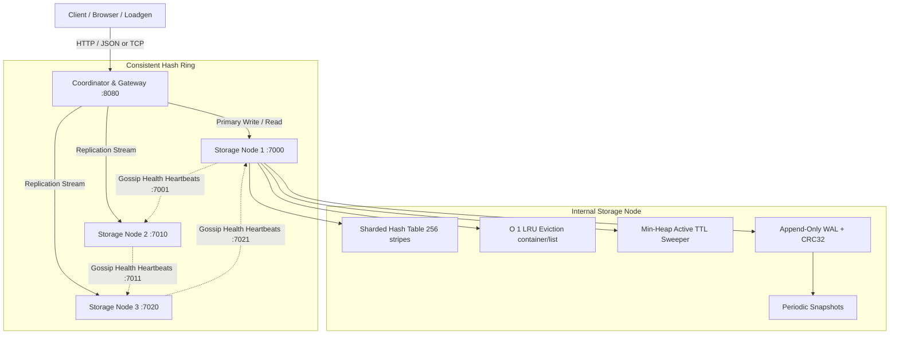
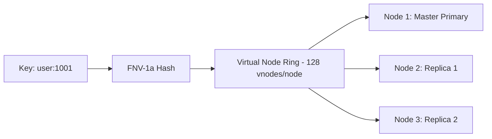
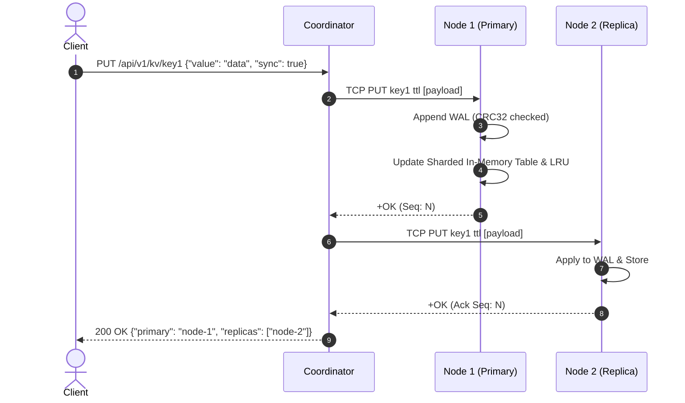
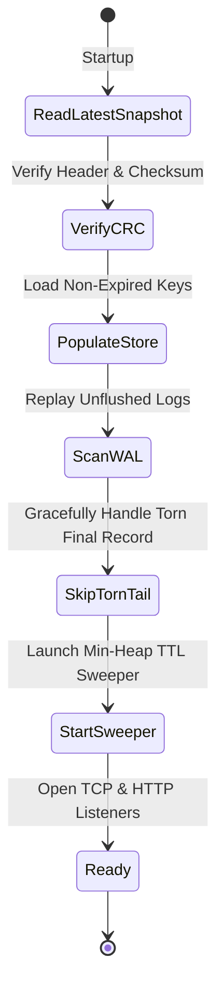

# miniKV Architecture & Design

miniKV is a distributed, high-performance in-memory key-value store in Go (1.22+) designed with consistent hashing, Write-Ahead Logging (WAL) with CRC32 integrity, replication, gossip-based failure detection, and an embedded web dashboard.

## System Architecture

## Consistent Hash Ring & Partitioning

## Write Path & Replication Protocol

## Recovery Flow

